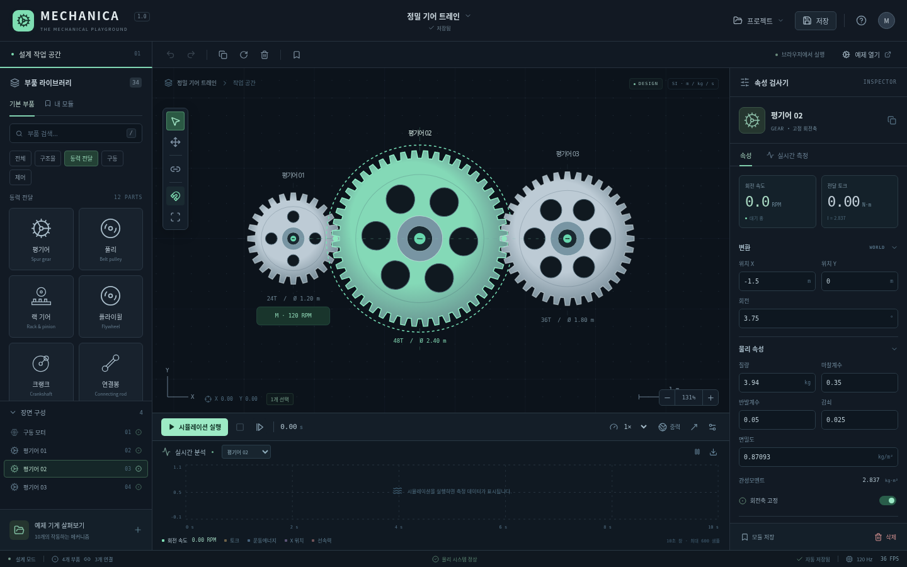

# MECHANICA

기계를 설계하고, 실제 토크와 부하로 실험하는 브라우저 기반 2D 기계공학 실험실입니다.

React 19 · TypeScript · Vite · Canvas 2D · Planck / Box2D · Zustand · IndexedDB · Vitest · Playwright.

소스 저장소: https://github.com/limwoobin9-hub/MECHANICA



## 바로 실행

배포 ZIP의 **`MECHANICA.html`** 을 Chrome으로 여세요. 앱 코드는 하나의 HTML 안에 포함됩니다. 실행에는 Python, Node.js, 외부 API, 계정 또는 인터넷 연결이 필요하지 않습니다. 브라우저/조직 정책이 로컬 HTML 실행을 막는 환경에서는 정적 배포 URL을 이용하세요.

저장은 브라우저의 IndexedDB를 사용합니다. 브라우저가 로컬 파일의 저장소를 제한하면 JSON 내보내기/가져오기를 사용하세요. 주소 또는 브라우저 프로필이 바뀌면 저장소가 공유되지 않습니다. 중요한 설계는 JSON으로 별도 보관하세요.

1. 처음 표시되는 기어 트레인에서 **시뮬레이션 실행** 또는 **Space**를 누릅니다.
2. 장면 구성에서 모터 또는 기어를 선택합니다.
3. 오른쪽 **구동 및 부하 → 저항 부하**를 높여 실제 모터 속도와 토크 변화를 관찰합니다.
4. **실시간 측정** 탭과 아래 그래프에서 결과를 확인합니다.
5. **정지 및 설계 복귀** 버튼으로 원래 부품 배치와 임시 물리 속성을 복원합니다. 표시·배속·중력 같은 환경 설정은 유지됩니다.

## 직접 설계

- 부품 카드를 작업 공간에 드래그하거나 카드를 클릭한 뒤 원하는 위치를 클릭합니다.
- 휠: 포인터를 중심으로 확대/축소. H 또는 휠 클릭: 카메라 이동. F: 전체 보기.
- 클릭: 선택. Shift+클릭 또는 빈 공간 드래그: 다중 선택. 그룹은 함께 이동합니다.
- 오른쪽에서 질량, 면밀도, 관성, 치수, 초기 속도, 마찰, 감쇠, 모듈, 톱니 수 등을 설정합니다. 숫자 입력은 Enter 또는 포커스 이동 시 확정합니다.
- C: 연결 도구. 연결 종류를 고른 뒤 첫 번째 부품과 두 번째 부품을 클릭합니다. 힌지/스프링/로프는 가장 가까운 연결점을 사용합니다.
- 격자 및 연결점 스냅을 지원합니다. Alt를 누르고 드래그하면 스냅을 일시 해제합니다.
- 기어는 같은 모듈과 올바른 중심거리가 필요합니다. 두 기어를 선택한 뒤 **기어 중심거리 맞추기**를 누르면 정확한 맞물림 위치로 옮깁니다.
- **동축 연결**은 중심을 겹친 두 회전축을 묶습니다. 복합 기어, 모터-기어, 기어-크랭크를 만들 수 있습니다.
- 힌지는 두 연결점을 겹친 후 연결합니다. 회전 부품은 회전축 고정을 켜거나 다른 강체에 힌지로 연결해야 기어/벨트를 사용할 수 있습니다.
- 사용자 모듈은 내부 연결, 센서 참조와 외부 연결점 좌표를 보존합니다. 불러온 모듈의 외부 포트는 연결 도구로 다시 연결할 수 있습니다. 기존 외부 부품과의 연결을 자동 복원하지는 않습니다.
- 시뮬레이션 중에는 드래그로 물체에 실제 힘을 가할 수 있습니다. 모터, 부하, 스위치 및 벨트/클러치 마찰·장력·활성 상태를 실시간으로 바꿀 수 있습니다. 구조 편집은 설계 모드에서 수행합니다.

## 예제 10개

| 예제 | 실제 계산되는 메커니즘 |
| --- | --- |
| 기본 기어 트레인 | 토크 제한 모터, 24T → 48T → 36T |
| 2단 복합 감속기 | 동축 복합 기어, 9:1 감속 |
| 크랭크–피스톤 | 편심 크랭크, 연결봉, 2개 힌지, 직선 레일 |
| 벨트 구동 장치 | 개방 벨트, 장력과 마찰 제한, 부하에 따른 슬립 |
| 스프링 진동 | 질량-스프링-댐퍼 |
| 기계식 시계 구동계 | 저속 동력원과 3개 감속 기어; 이스케이프먼트 없음 |
| 자동차 구동계 | 움직이는 차체에 장착한 모터 기어, 감속 기어, 차축, 타이어 접촉 |
| 자동화 컨베이어 | 구동축, 실제 접촉면 속도, 운반 상자, 접촉 센서, 타이머, NOT/AND |
| 4절 링크 | 두 회전축과 닫힌 강체 링크 |
| 복합 자동화 기계 | 모터 → 24T → 48T → 크랭크 → 연결봉 → 피스톤; 논리 제어 |

모든 예제는 `src/model/examples.ts`의 일반 부품/연결 데이터입니다. 예제만을 위한 각도·위치 애니메이션 코드는 없습니다. 내장 예제 및 `examples/*.mechanica.json`은 편집하고 다시 저장할 수 있습니다.

## 개발

Node.js 22.12+ 또는 24와 npm을 사용합니다. Node는 소스 개발/빌드에만 필요합니다.

```sh
npm ci
npm run dev
```

```sh
npm test
npm run build
npm run test:e2e
```

브라우저 테스트는 `/usr/bin/chromium`이 있으면 이를 사용합니다. 없는 개발 환경에서는 `npx playwright install chromium`으로 Playwright 브라우저를 설치한 후 실행하세요. `npm run build`는 외부 JS/CSS 요청이 없는 단일 HTML `dist/index.html`을 생성합니다.

예제 JSON을 다시 생성하려면 `npm run examples`를 실행합니다.

## GitHub / Vercel 정적 배포

GitHub 저장소에 소스를 올린 뒤 Vercel에서 가져옵니다. Framework: **Vite**, Build: **`npm run build`**, Output: **`dist`**. 환경 변수나 서버 함수, 데이터베이스, 유료 API가 필요 없습니다. `vercel.json`을 포함했습니다. 빌드 마지막 단계는 오프라인 앱·전체 소스·테스트·설명서를 담은 `dist/MECHANICA.zip`도 자동 생성하며 앱의 프로젝트 메뉴에서 다운로드할 수 있습니다.

GitHub Actions의 `ci.yml`은 테스트와 프로덕션 빌드를 실행합니다. GitHub Pages 배포는 저장소 Settings → Pages에서 GitHub Actions를 선택한 뒤 **Deploy to GitHub Pages** 워크플로를 수동 실행합니다. 상대 경로 및 단일 HTML 빌드이므로 저장소 하위 경로에서도 실행됩니다. 이 패키지는 GitHub 저장소 생성이나 기존 사이트 변경을 자동으로 수행하지 않습니다.

## 구조

```text
src/model/       버전 1 프로젝트 스키마, 부품, 예제, 모듈
src/physics/     SI 단위 강체 엔진, 기계 연결 검증, 벨트 마찰, 제어 회로
src/store/       Undo/Redo, 편집 상태, 시뮬레이션 상태, IndexedDB
src/components/  Canvas 렌더러, 라이브러리, 검사기, 계측 그래프, 대화상자
tests/           물리·자동화·저장·모듈 자동 테스트
tests/browser/   실제 Chromium 사용 흐름 테스트
docs/            물리 모델과 검증 범위
examples/        가져오기 가능한 10개 예제 프로젝트
```

## 범위와 한계

이 버전은 작동하는 핵심 기계 실험실입니다. 산업용 치면 해석기나 전체 요구 사양의 모든 세부 기능이 완성된 CAD는 아닙니다. 이상적인 강체 기어, 원형 풀리, 마찰 제한 벨트/클러치, 크랭크·슬라이더·힌지·스프링, 캠 접촉, 래칫, 힘/토크/브레이크, 접촉 기반 컨베이어와 논리 제어를 구현했습니다.

미구현 항목은 **인벌류트 치면 접촉·백래시·재료 변형·파손·기어 허용 토크의 강제 단절**, **도르래를 경유하는 로프 경로 및 로프 질량**, **임의 캠 프로파일**, **이스케이프먼트**, **다중 채널 그래프 중첩/가속도 벡터**, **마우스 핸들에 의한 직접 크기 조절/회전**입니다. 치수·회전은 속성창과 단축키로 편집합니다. 외부 모듈 포트에는 연결 좌표를 보존하며 이름/타입을 별도로 설계하는 포트 편집기는 없습니다.

상세한 단순화, 방정식, 에너지·단위·안정성 및 테스트 범위는 **`docs/PHYSICS.md`**와 **`docs/VERIFICATION.md`**를 확인하세요.
